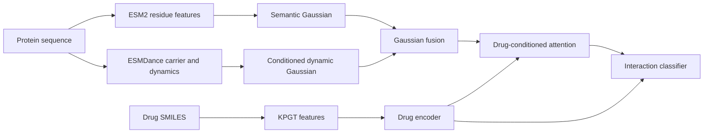

# SAGF-DTI

SAGF-DTI is a drug–target interaction prediction model that integrates protein semantic representations and predicted dynamic properties through Gaussian fusion. The model uses KPGT molecular features, ESM2 residue features, and ESMDance dynamic features, followed by drug-conditioned attention for interaction prediction.

[中文说明](README.zh-CN.md) · [Data preparation](docs/preparation.md) · [Training protocol](docs/protocol.md)

## Method

- **Molecular representation:** KPGT provides pretrained drug features.
- **Protein representation:** ESM2 encodes residue semantics; ESMDance provides a carrier representation and predicted dynamic properties for the conditioned dynamic branch.
- **Gaussian fusion:** residue-level semantic and dynamic Gaussians are integrated using a tempered product of experts with a semantic anchor.
- **Interaction prediction:** drug-conditioned attention aggregates the fused residue features. Training combines interaction classification with auxiliary branch prediction, reliability supervision, and drug/target contrastive learning.



The training pipeline uses cached pretrained features. See the [method and training protocol](docs/protocol.md) for architecture details and hyperparameters.

## Installation

Clone the repository and create a Python 3.11 environment. The following example installs the Linux CUDA 12.8 runtime:

```bash
git clone https://github.com/Santax1238/SAGF-DTI.git
cd SAGF-DTI

python3.11 -m venv .venv
source .venv/bin/activate
python -m pip install --upgrade pip
python -m pip install -r requirements-blackwell.txt
python -m pip install --no-deps -e .
python scripts/check_environment.py --device cuda
```

For CPU installation, conda setup, and platform-specific options, see [environment setup](docs/environment.md). Raw feature extraction uses the upstream KPGT and SeqDance environments described in the preparation guide.

## Data preparation

Prepare the drug tables, protein tables, cached features, similarity matrices, and dataset splits using the [data preparation guide](docs/preparation.md). The [data specification](docs/data.md) describes their formats. Datasets and pretrained weights are obtained separately from their original providers.

For example, a SNAP experiment expects the following layout:

```text
DATA_ROOT/
└── SNAP/biofusion1500_front/
    ├── drugs.csv
    ├── targets.csv
    ├── kpgt/kpgt.npz
    ├── graphs/esmdance_node_cond35_dyn50/
    ├── contrastive/
    └── biofusion_official_splits/
```

Set the feature root and validate the inputs:

```bash
export DATA_ROOT=/absolute/path/to/features

python -m sagf_dti validate-data \
  --config configs/paper/SNAP/prot/seed_42.yaml \
  --data-root "$DATA_ROOT" --inspect-features
```

Only the dataset selected by the configuration needs to be prepared.

## Training and evaluation

Train one SNAP cold-protein experiment:

```bash
python -m sagf_dti train \
  --config configs/paper/SNAP/prot/seed_42.yaml \
  --data-root "$DATA_ROOT" --output runs/single \
  --require-paper-config
```

Training selects the checkpoint with the highest validation AUROC and then evaluates it on the test set. Each run saves its configuration, training metrics, predictions, and checkpoints in a subdirectory of the output root.

To evaluate a saved model independently, replace the checkpoint path with the run's `checkpoints/best.pt`:

```bash
python -m sagf_dti evaluate \
  --config configs/paper/SNAP/prot/seed_42.yaml \
  --data-root "$DATA_ROOT" --checkpoint /absolute/path/to/best.pt \
  --output evaluations/snap_prot_42 --split test
```

## Reproducing experiments

Configurations are provided for all dataset, split, and seed combinations:

| Option | Values |
| --- | --- |
| Dataset | `SNAP`, `DRH`, `Kinase` |
| Split | `random` (random), `drug` (cold drug), `prot` (cold protein) |
| Seed | `42`, `1234`, `3407`, `5678`, `8888` |
| Configuration path | `configs/paper/<dataset>/<split>/seed_<seed>.yaml` |

Run all five seeds for SNAP cold protein and summarize the results:

```bash
for seed in 42 1234 3407 5678 8888; do
  python -m sagf_dti train \
    --config "configs/paper/SNAP/prot/seed_${seed}.yaml" \
    --data-root "$DATA_ROOT" --output runs/snap_prot \
    --require-paper-config
done

python -m sagf_dti summarize \
  --runs runs/snap_prot --output reports/snap_prot
```

The summary reports mean and sample standard deviation after all five seeds complete. Use a new output root for each experiment. The [reproduction guide](docs/reproduction.md) describes the full protocol, automated runner, and run outputs.

## Repository structure

```text
configs/paper/       Dataset, split, and seed configurations
sagf_dti/            Training, evaluation, and data-validation entry points
my_experiments/     Original model, dataset, and training implementation
scripts/            Feature preparation and experiment utilities
docs/               Environment, data, method, and reproduction guides
```

## Acknowledgements

This project uses pretrained representations from [KPGT](https://github.com/lihan97/KPGT), [ESM2](https://github.com/facebookresearch/esm), and [SeqDance / ESMDance](https://github.com/ShenLab/SeqDance). Please refer to [third-party notices](THIRD_PARTY_NOTICES.md) for attribution and component licensing.
