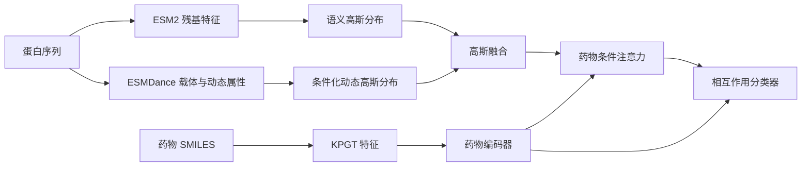

# SAGF-DTI

SAGF-DTI 是用于药物—靶标相互作用预测的高斯融合模型。模型结合 KPGT 药物表示、ESM2 蛋白残基语义表示与 ESMDance 预测动态属性，通过高斯融合整合蛋白信息，再利用药物条件注意力完成相互作用预测。

[English](README.md) · [数据准备](docs/preparation.md) · [训练协议](docs/protocol.md)

## 方法概览

- **药物表示：**使用 KPGT 预训练分子特征。
- **蛋白表示：**使用 ESM2 编码残基语义，并使用 ESMDance 载体表示和预测动态属性构建条件化动态分支。
- **高斯融合：**将残基语义和动态特征表示为高斯分布，通过带语义锚定的 tempered product of experts 进行融合。
- **相互作用预测：**使用药物条件注意力汇聚融合后的残基特征。训练结合相互作用分类、分支辅助预测、可靠性监督及药物／蛋白对比学习。



训练使用预先缓存的预训练特征。模型细节和超参数见[方法与训练协议](docs/protocol.md)。

## 环境安装

克隆仓库并创建 Python 3.11 环境。以下命令适用于 Linux、CUDA 12.8：

```bash
git clone https://github.com/Santax1238/SAGF-DTI.git
cd SAGF-DTI

python3.11 -m venv .venv
source .venv/bin/activate
python -m pip install --upgrade pip
python -m pip install -r requirements-blackwell.txt
python -m pip install --no-deps -e .
python scripts/check_environment.py --device cuda
```

CPU、conda 及不同平台的配置见[环境说明](docs/environment.md)。原始特征提取使用预处理指南中的 KPGT 和 SeqDance 上游环境。

## 数据准备

按照[数据准备指南](docs/preparation.md)生成药物表、蛋白表、特征缓存、相似矩阵和数据划分；各文件的格式见[数据说明](docs/data.md)。数据集和预训练权重需从各自的原始来源获取。

以 SNAP 为例，目录结构如下：

```text
DATA_ROOT/
└── SNAP/biofusion1500_front/
    ├── drugs.csv
    ├── targets.csv
    ├── kpgt/kpgt.npz
    ├── graphs/esmdance_node_cond35_dyn50/
    ├── contrastive/
    └── biofusion_official_splits/
```

设置特征根目录并检查输入：

```bash
export DATA_ROOT=/absolute/path/to/features

python -m sagf_dti validate-data \
  --config configs/paper/SNAP/prot/seed_42.yaml \
  --data-root "$DATA_ROOT" --inspect-features
```

单次实验只需准备配置中选择的数据集。

## 训练与评估

运行一个 SNAP 冷蛋白实验：

```bash
python -m sagf_dti train \
  --config configs/paper/SNAP/prot/seed_42.yaml \
  --data-root "$DATA_ROOT" --output runs/single \
  --require-paper-config
```

训练根据验证集 AUROC 选择最佳模型，再评估测试集。配置、训练指标、预测结果和模型权重会保存在输出根目录下的实验子目录中。

独立评估时，将下面的模型路径替换为实验生成的 `checkpoints/best.pt`：

```bash
python -m sagf_dti evaluate \
  --config configs/paper/SNAP/prot/seed_42.yaml \
  --data-root "$DATA_ROOT" --checkpoint /absolute/path/to/best.pt \
  --output evaluations/snap_prot_42 --split test
```

## 运行论文实验

仓库提供以下数据集、划分和随机种子的全部组合配置：

| 选项 | 支持值 |
| --- | --- |
| 数据集 | `SNAP`、`DRH`、`Kinase` |
| 划分 | `random`：随机；`drug`：冷药物；`prot`：冷蛋白 |
| 随机种子 | `42`、`1234`、`3407`、`5678`、`8888` |
| 配置路径 | `configs/paper/<dataset>/<split>/seed_<seed>.yaml` |

运行 SNAP 冷蛋白的五个种子，并汇总结果：

```bash
for seed in 42 1234 3407 5678 8888; do
  python -m sagf_dti train \
    --config "configs/paper/SNAP/prot/seed_${seed}.yaml" \
    --data-root "$DATA_ROOT" --output runs/snap_prot \
    --require-paper-config
done

python -m sagf_dti summarize \
  --runs runs/snap_prot --output reports/snap_prot
```

五个种子全部完成后，汇总程序输出均值和样本标准差。每组新实验使用新的输出根目录。完整协议、自动实验入口和输出说明见[复现指南](docs/reproduction.md)。

## 仓库结构

```text
configs/paper/       数据集、划分和随机种子配置
sagf_dti/            训练、评估与数据检查入口
my_experiments/     原始模型、数据加载与训练实现
scripts/            特征预处理与实验工具
docs/               环境、数据、方法与复现说明
```

## 致谢

本项目使用 [KPGT](https://github.com/lihan97/KPGT)、[ESM2](https://github.com/facebookresearch/esm) 和 [SeqDance / ESMDance](https://github.com/ShenLab/SeqDance) 的预训练表示。相关来源及组件许可见[第三方声明](THIRD_PARTY_NOTICES.md)。
